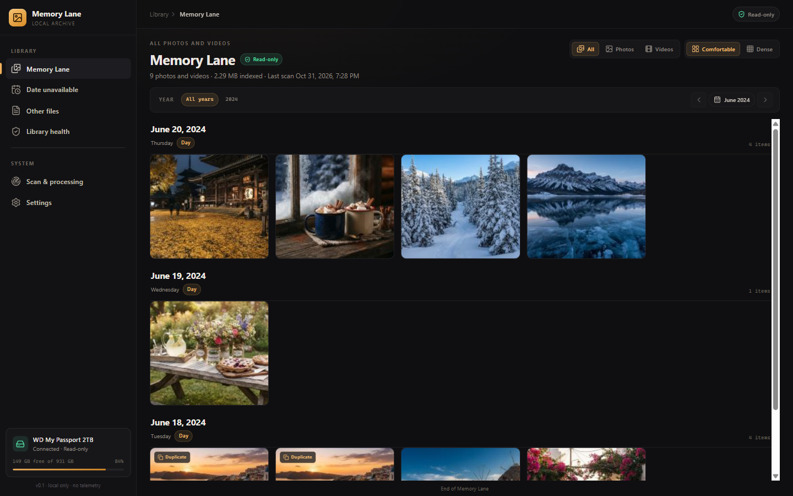
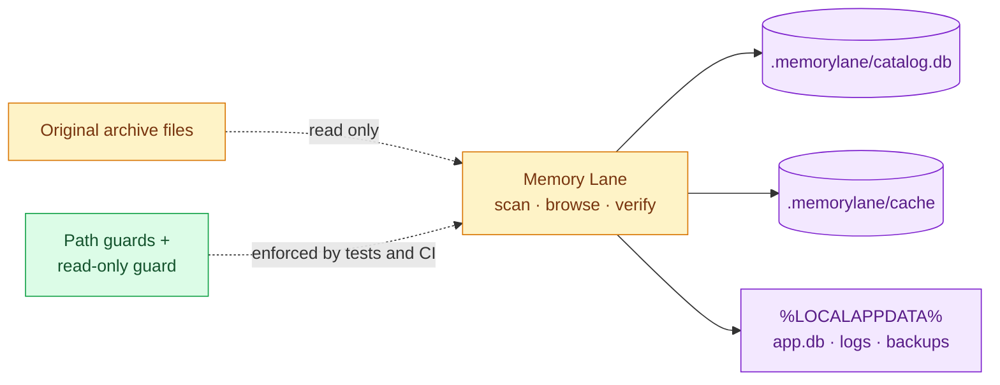
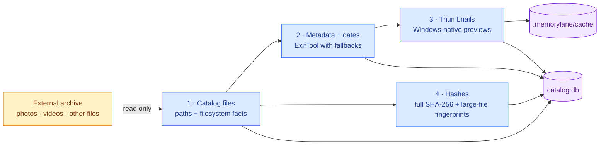
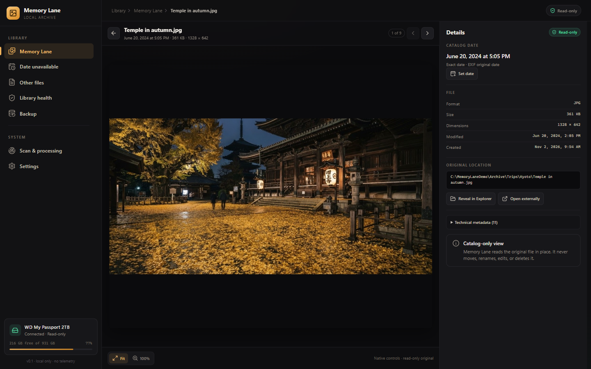
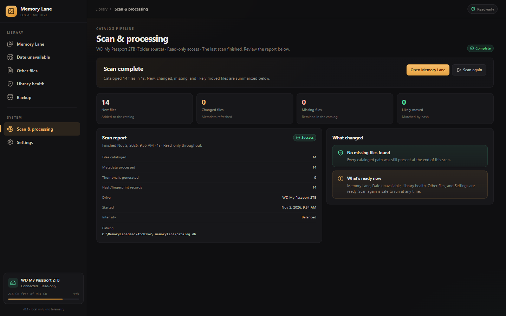
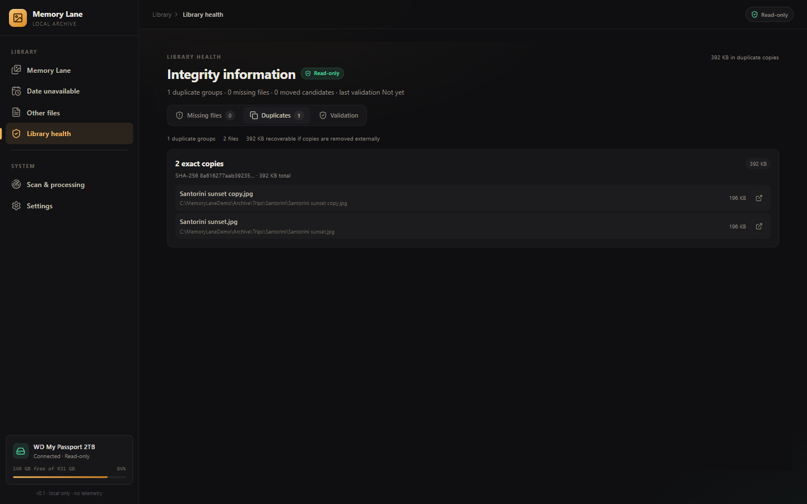
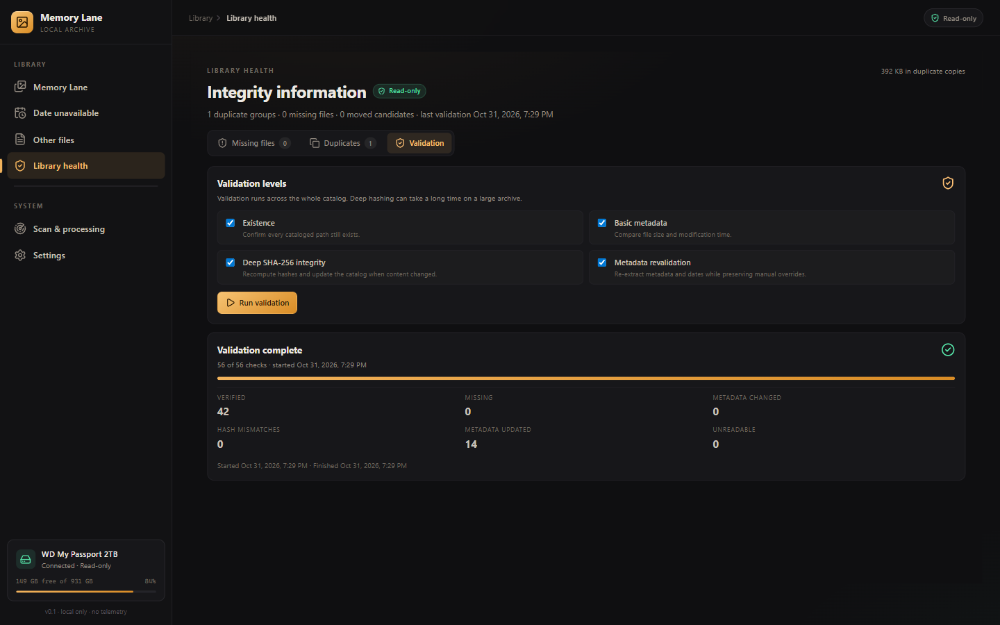
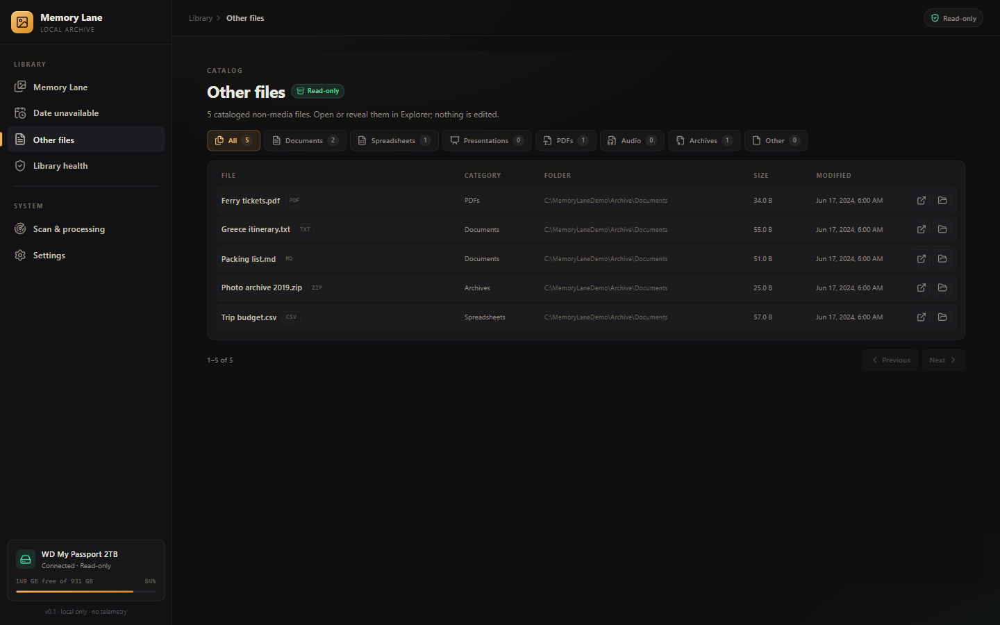
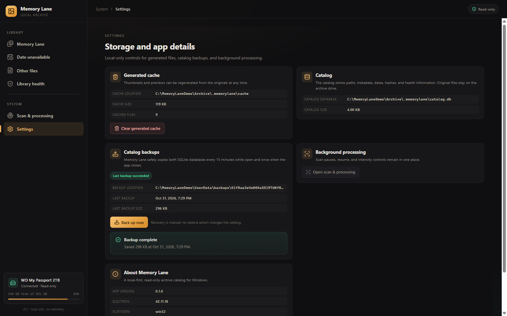
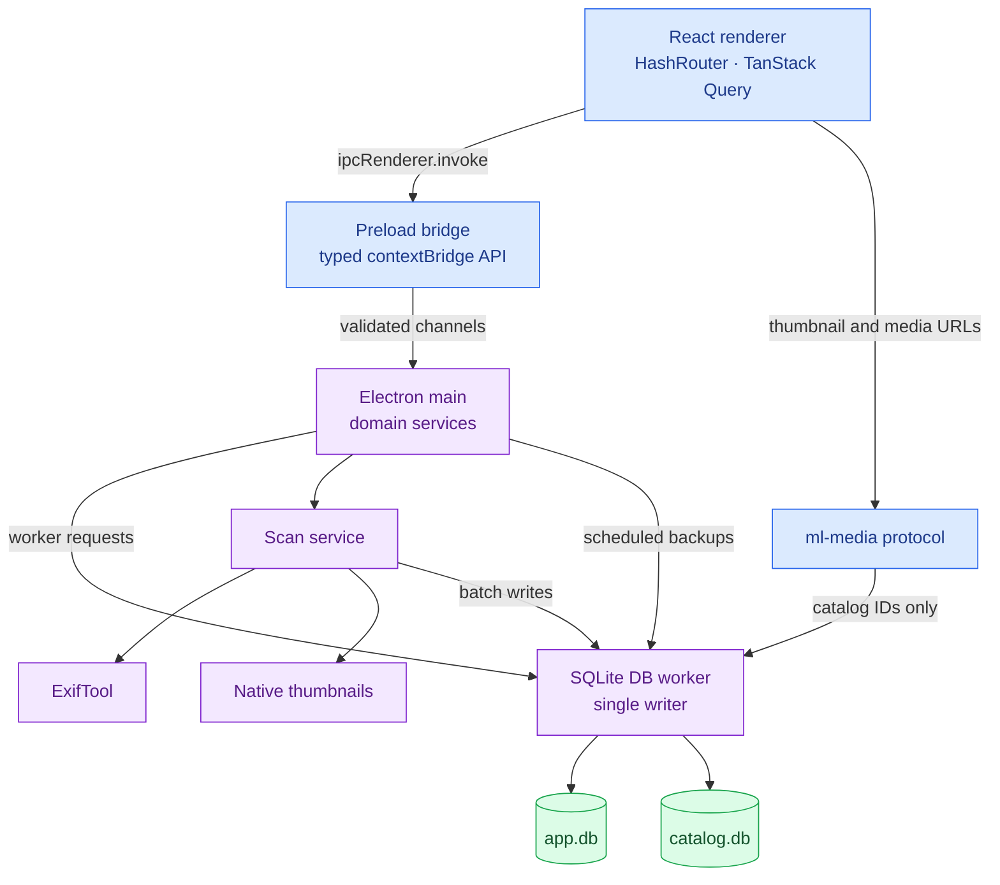

# Memory Lane

**A local-first, read-only memory archive for Windows.**

Memory Lane catalogs photos, videos, documents, and everything else on external
drives so the archive can be browsed, dated, searched by category, and checked
for integrity. It never moves, renames, edits, or deletes the originals.



---

## The archive stays the archive

Most catalog tools try to become the library. Memory Lane deliberately does not.
The drive remains the source of truth; the catalog is a local index that can be
rebuilt, backed up, and discarded without touching a single original.



Every write is scoped to app-managed locations. The quality gate scans the
main process for filesystem write APIs and rejects anything outside the reviewed
cache, lock, backup, and replication allowlist. Replication writes go through a
registered-destination writer, and promotion writes only snapshots and catalog
metadata. The source archive remains read-only.

## One scan, four stages

A scan builds the catalog in four independent stages. Browsing unlocks after the
catalog stage, so a large archive is usable before hashing and thumbnail work
finish.



Scans pause and resume explicitly, survive app restarts and disconnects, and
record every stage in the per-drive catalog. A running scan can be interrupted
without losing completed work.

## The application

| Media viewer | Scan & processing |
| --- | --- |
|  |  |
| Photo and video playback, date details, manual date overrides, previous/next navigation, reveal in Explorer, and external open. | Four stage cards, pause/resume/intensity, live progress, a completion report, and safe reconnect behavior. |

| Library health | Validation report |
| --- | --- |
|  |  |
| Exact duplicate groups, missing and moved files, and whole-catalog validation with pause/resume. | Existence, metadata, deep SHA-256, and metadata revalidation with a per-run report. |

| Other files | Settings |
| --- | --- |
|  |  |
| Documents, spreadsheets, presentations, PDFs, audio, archives, and other files with external open/reveal. | Generated cache size/clear, catalog location, backup status, background controls, About, and an explicit offline/read-only statement. |

## How it is put together

The renderer never receives Node.js or direct database access. A typed preload
bridge exposes a narrow IPC surface, and every request is validated before it
reaches the services.



A few decisions shape the rest:

- **One SQLite writer.** The worker owns both `app.db` and the active
  `catalog.db`. Renderer and main-process services never open SQLite directly.
- **One catalog per drive.** `<drive>\.memorylane\catalog.db` is self-contained,
  versioned, and portable with the drive.
- **IDs, not paths, over media URLs.** `ml-media:` resolves catalog IDs in the
  worker, so the renderer cannot ask for an arbitrary filesystem path.
- **Contracts first.** Zod schemas define IPC payloads and shared types; the
  preload bridge is generated from the same contract.
- **Crash-safe writes.** SQLite WAL mode, migrations, graceful-close backups,
  and a resumable scan session make interruption boring.

The full architecture and data model are in
[`docs/product/scope-and-implementation.md`](docs/product/scope-and-implementation.md).
The IPC and media contracts are in
[`docs/contracts/scan.md`](docs/contracts/scan.md),
[`docs/contracts/library.md`](docs/contracts/library.md),
[`docs/contracts/health.md`](docs/contracts/health.md),
[`docs/contracts/other-files.md`](docs/contracts/other-files.md), and
[`docs/contracts/settings.md`](docs/contracts/settings.md).

## What is built today

- **Four-stage scanning** with pause/resume, intensity control, incremental
  changes, missing/moved detection, and interruption recovery.
- **Large-file lazy hashing** with sampled fingerprints for unique files and full
  SHA-256 on duplicate, move, replication, or validation demand.
- **Memory Lane** timeline with a virtualized grid, filters, density, year/month
  navigation, viewport-priority thumbnails, and a combined photo/video viewer.
- **WMV/3GP playback** through cached FFmpeg-compatible MP4 copies, with
  preparation progress, retry, and external-open fallback.
- **ExifTool dates** with EXIF/XMP/video extraction, a documented priority
  chain, Date unavailable, and reversible catalog-only overrides.
- **Library health** with exact duplicate groups, missing/moved-file actions,
  and four-level whole-catalog validation.
- **Other files** categories with pagination, external open, and reveal.
- **Settings** for generated cache, catalog location, backup status, background
  controls, and About.
- **SQLite-safe PC backups** every 15 minutes and on graceful close, with manual
  recovery documented.
- **Hardening**: 100k/200k performance coverage, simulated disconnect and
  unclean-restart drills, a backup-restore drill, tightened IPC/CSP controls, a
  read-only guard, SHA-256 package checksums, and an expanded packaged smoke.
- **Partial and full backups**: adopted destination libraries, resumable partial
  runs, complete full copies, source-growth degradation, and metadata-only
  promotion with rollback.
- **522 automated tests** across 133 files, 10 Electron E2E flows, and a packaged
  app smoke covering scan, library, Other files, Settings, backup, cache, and
  WMV compatible playback.

Phase 6 automated hardening is complete. The manual release pass (clean Windows
VM install/uninstall, physical USB disconnect, codec playback, 200k memory
measurement, a real 2 TB archive, and the replication promotion/rollback drills)
remains in
[`docs/release/release-checklist.md`](docs/release/release-checklist.md).

## Quality gates

```powershell
npm run check          # typecheck, lint, format, size, read-only, architecture, knip
npm run test:coverage  # unit, component, integration, coverage floors
npm run test:e2e       # Playwright Electron flows
npm run check:full     # all of the above
npm run test:perf      # 100k catalog query pass (200k with MEMORY_LANE_PERF_200K=1)
```

The suite covers contracts, repositories, migrations, scan coordination, media
range responses, disconnect/recovery, backup restore, renderer states, E2E
flows, and the packaged app. Coverage floors are 80% overall and 90% for shared
contracts and database code.

## Run it

Node **22.12+** is required. The repository includes `.nvmrc` and
`.node-version`.

```text
npm ci
npm run dev
```

`npm run dev` rebuilds `better-sqlite3` for Electron, starts Vite, and launches
the desktop shell. React and CSS changes hot-reload; main-process changes rebuild
and relaunch Electron. DevTools are enabled in development.

### Build a Windows package

```powershell
npm run package:win        # NSIS installer + portable executable
npm run package:unpacked   # refresh release\win-unpacked for local testing
npm run verify:package     # binaries, runtime files, SHA-256SUMS.txt
npm run smoke:packaged     # scan → Other files → backup → cache clear
```

Artifacts:

```text
release\Memory-Lane-Setup-0.1.0-x64.exe   Per-user NSIS installer
release\Memory-Lane-0.1.0-x64.exe         Portable executable
release\win-unpacked\Memory Lane.exe      Unpacked app for quick testing
release\SHA256SUMS.txt                    SHA-256 checksums
```

The installer is per-user and does not require administrator rights. There is no
auto-updater. App data, catalogs, and backups survive uninstall.

### Development notes

Native module note: `better-sqlite3` must match the running ABI. Test scripts
rebuild it for Node; development, E2E, and packaging use the pinned Electron
prebuild. `electron-builder` sets `npmRebuild: false` because the correct binary
is already selected.

SQLite locations:

```text
%LOCALAPPDATA%\MemoryLane\app.db          Installed app state
%LOCALAPPDATA%\MemoryLane-dev\app.db      Development app state
<drive>\.memorylane\catalog.db            Per-drive catalog
<drive>\.memorylane\cache\                Generated thumbnails and previews
%LOCALAPPDATA%\MemoryLane\backups\        PC-side SQLite backups
```

`npm run screenshots:readme` rebuilds the unpacked app and refreshes the
screenshots in `docs/images/` from the packaged UI.

Memory Lane is a desktop app that needs a native window, drive letters, Windows
Explorer integration, and media playback. Docker is not a runtime dependency;
packaging uses Electron Builder, NSIS, and a Windows CI runner.

## Documentation

Start at [`docs/README.md`](docs/README.md).

| Document | Purpose |
| --- | --- |
| [`product/product-specification.md`](docs/product/product-specification.md) | Product vision and requirements |
| [`product/scope-and-implementation.md`](docs/product/scope-and-implementation.md) | Scope, architecture, data model, quality gates |
| [`product/roadmap.md`](docs/product/roadmap.md) | Delivered phases and next work |
| [`product/partial-backups.md`](docs/product/partial-backups.md) | Replication behavior: adoption, copies, libraries, promotion |
| [`product/replication-implementation-plan.md`](docs/product/replication-implementation-plan.md) | Replication slices, architecture, test matrix |
| [`archive/phase-history.md`](docs/archive/phase-history.md) | Preserved Phase 3-6 scope, decisions, and limits |
| [`contracts/scan.md`](docs/contracts/scan.md) | Scan IPC, state, stages, and reports |
| [`contracts/library.md`](docs/contracts/library.md) | Library IPC, media protocol, viewer |
| [`contracts/health.md`](docs/contracts/health.md) | Health IPC, duplicates, validation |
| [`contracts/other-files.md`](docs/contracts/other-files.md) | Other files IPC and categories |
| [`contracts/settings.md`](docs/contracts/settings.md) | Settings, cache, backup, recovery |
| [`contracts/replication.md`](docs/contracts/replication.md) | Replication IPC, runs, destinations, media, promotion |
| [`release/acceptance.md`](docs/release/acceptance.md) | v0.1 and replication acceptance criteria and sign-off |
| [`release/release-checklist.md`](docs/release/release-checklist.md) | Clean-VM, physical-drive, and replication release pass |
| [`release/security-review.md`](docs/release/security-review.md) | Trust boundaries, controls, residual risks |
| [`release/codec-matrix.md`](docs/release/codec-matrix.md) | Codec expectations and external fallbacks |
| [`release/third-party-notices.md`](docs/release/third-party-notices.md) | Bundled FFmpeg license and source notice |
| [`adr/`](docs/adr/README.md) | Architecture decision records |

The static files in `ui-mockups/` are a design reference only; the screenshots
above are captured from the packaged application.

## Roadmap

| Phase | Focus | Status |
| --- | --- | --- |
| 0 | Foundation | Complete |
| 1 | Drive and scan | Complete |
| 2 | Memory Lane | Complete |
| 3 | Dates | Complete |
| 4 | Integrity | Complete |
| 5 | Other files and Settings | Complete |
| 6 | Hardening | Automated complete; manual release pass pending |
| Post-v0.1 | Replication and promotion | Automated complete; physical-drive pass pending |

The status table in [`docs/product/roadmap.md`](docs/product/roadmap.md) is the source of truth.

## Future features

These are post-v0.1 and are not part of current acceptance criteria:

- **Places map** — local-only globe for items with valid GPS metadata.
- **Non-memory images** — local-only classification of screenshots, receipts,
  and documents with review-only suggestions.
- **Search and saved filters** — keyword search over names, paths, and metadata.
- **Favorites and collections** — user organization that never modifies
  originals.

## License

Memory Lane is released under the MIT License. See [`LICENSE`](LICENSE) for the
full text. Third-party components are listed in
[`THIRD_PARTY_NOTICES.md`](THIRD_PARTY_NOTICES.md).
